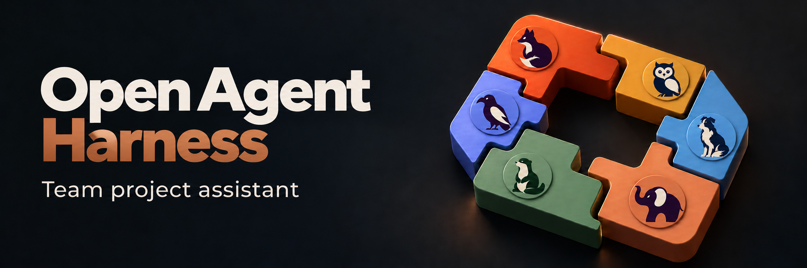
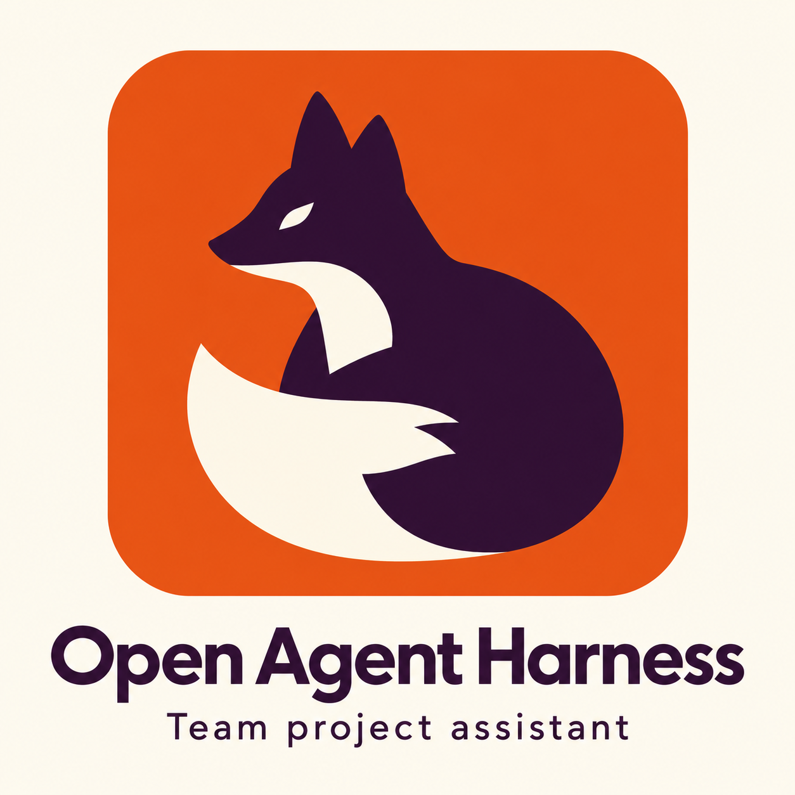
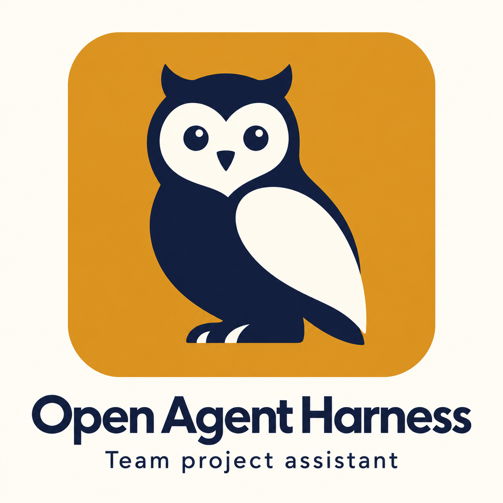
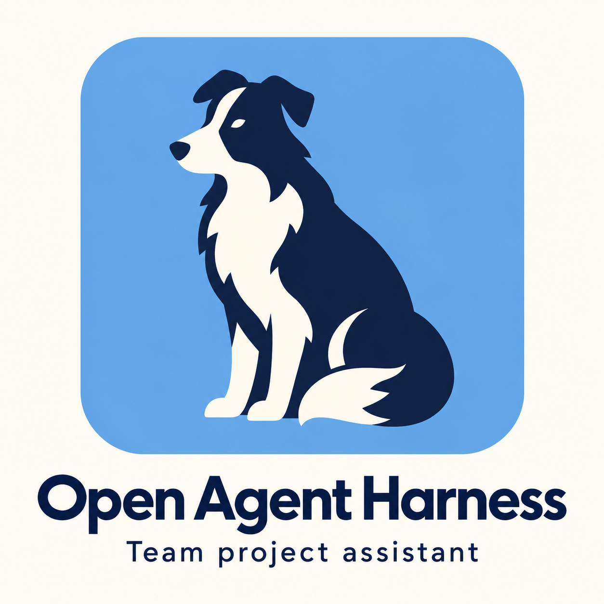
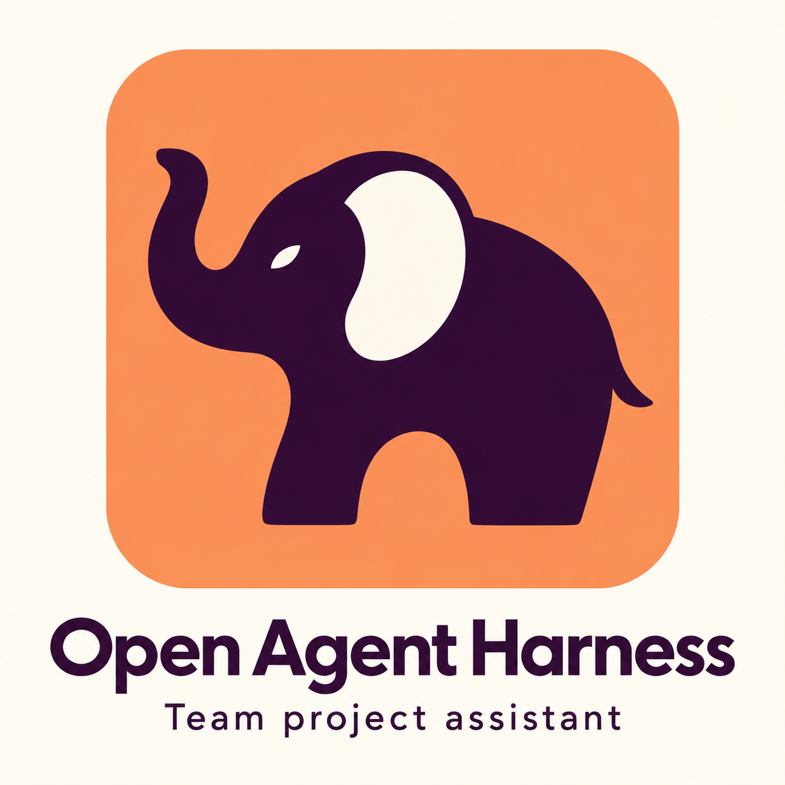
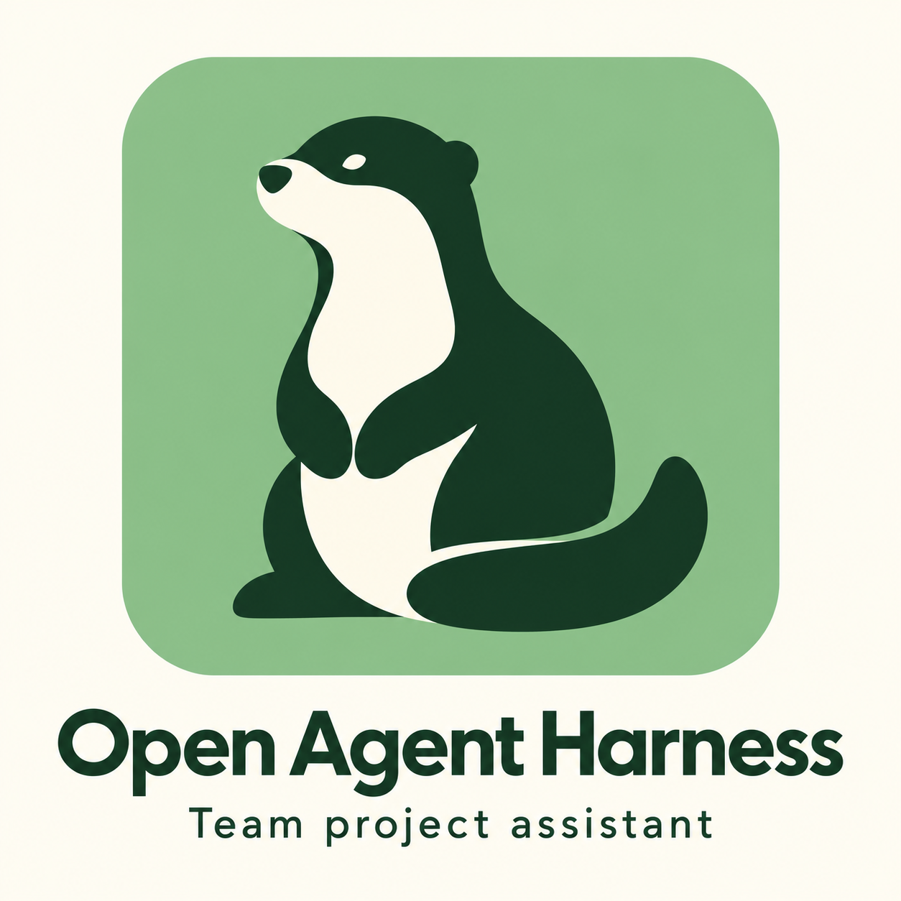
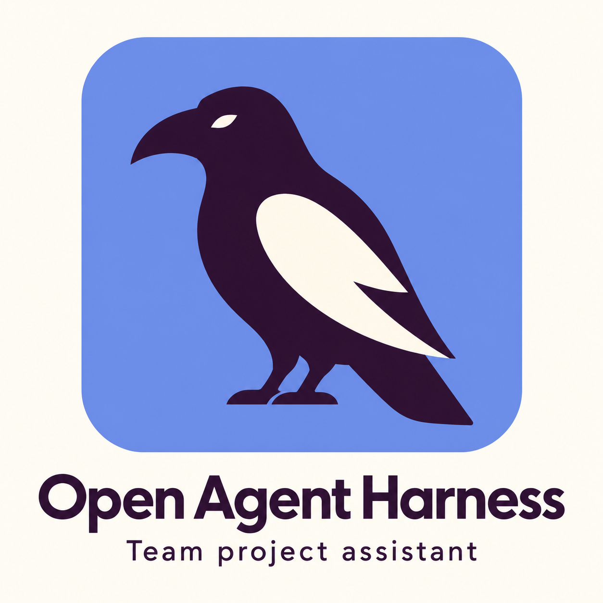
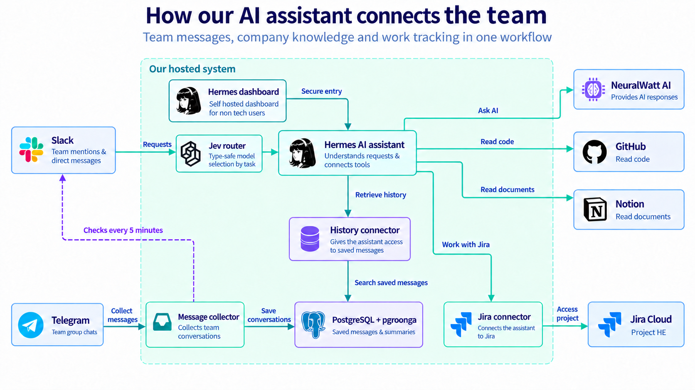
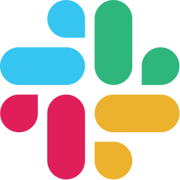
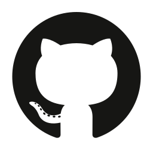

<div align="center">



<!-- # Open Agent Harness -->

**Any project. Any domain. Start with Open Agent.**

A self-hosted Slack assistant for searching team conversations, issues, docs, and code.
Built on [Hermes Agent](https://github.com/NousResearch/hermes-agent).

[](LICENSE)
[](#quick-start)
[](#configuration)
[](#quick-start)

[Integrations](#configuration) · [Architecture](#architecture) · [Security](#security) · [Contributing](#contributing)

</div>

Ask a question in Slack. Open Agent searches collected Slack and Telegram history and, when configured,
Jira, GitHub, and Notion. Its instructions require source references and a clear distinction between
proposals and decisions. Longer reports can be attached as Markdown or ZIP files.

Run it with Docker Compose. Add credentials to [`.env`](.env.example) and describe your project in
[`hermes/SOUL.md`](hermes/SOUL.md).

## Intro video

<div align="center">

<video src="docs/readme-intro.mp4" width="640" height="360" controls preload="metadata"></video>

<p><a href="docs/readme-intro.mp4">Watch the 26-second video</a></p>

</div>

## Meet Open Agent

Six mascots represent the assistant's roles. They are branding concepts, not separate agents.

| Fox | Owl | Border collie | Elephant | Otter | Raven |
|:---:|:---:|:---:|:---:|:---:|:---:|
| [](docs/icon-concepts/32-fox-curled.png) | [](docs/icon-concepts/34-animal-owl.png) | [](docs/icon-concepts/35-animal-collie.png) | [](docs/icon-concepts/36-animal-elephant.png) | [](docs/icon-concepts/37-animal-otter.png) | [](docs/icon-concepts/38-animal-raven.png) |
| Solve problems | Find knowledge | Coordinate work | Remember decisions | Help the team | Connect the clues |

## What you can ask

Try these after connecting your sources:

| Ask in Slack | What the agent looks for |
|---|---|
| “What did we decide about the onboarding flow last week?” | Discussions and dates that show what was proposed and what was agreed. |
| “Who owns this bug, and what is blocking it?” | Jira status, assignee, and related team discussions. |
| “What shipped this week?” | GitHub changes, Jira issues, and recent team updates. |
| “Turn this discussion into a Jira issue.” | An issue draft for you to confirm before it writes to Jira. |
| “Give me the full report as a Markdown file.” | A downloadable file attached to the Slack reply. |

The assistant can only answer from the sources and history it can access.

## What it does

- Collects Slack history every five minutes and Telegram messages as they arrive.
- Searches messages in PostgreSQL with PGroonga. Scheduled summaries help it find older discussions.
- Answers channel mentions and direct messages from allowed Slack users through Socket Mode.
- Reads connected Jira, GitHub, and Notion sources. Jira writes require confirmation under the bundled instructions.
- Runs scheduled jobs and exports reports to Slack.
- Uses an OpenAI-compatible model with tool calling. Optional TypeSafe Jev routing selects a model and reasoning effort per message.

The message database runs on your infrastructure. Relevant content is sent to your model provider and
connected services. See [Security](#security) for access and data-handling limits.

## Quick start

Install the setup skill into your coding agent (Claude Code, Codex, Cursor, Gemini CLI and
[others](https://github.com/vercel-labs/skills)):

```bash
npx skills add MUST-Company-AX-Booster/Open-Agent-Harness --skill open-agent-setup
```

Then ask your agent:

```text
Set up Open Agent for my team.
```

The agent clones this repository, fills in `.env`, describes your team in `hermes/SOUL.md`, configures the
integrations you pick, and starts the stack. It stops and tells you when a step needs your browser or phone,
such as creating the Slack app. No Node.js? Point your agent at
[`skills/open-agent-setup/SKILL.md`](skills/open-agent-setup/SKILL.md) and tell it to follow the file.

### Manual setup

You need Git, Docker with the Compose plugin, permission to install a Slack app, and an API key for a
model that supports tool calling.

#### 1. Clone and configure

```bash
git clone --recurse-submodules https://github.com/MUST-Company-AX-Booster/Open-Agent-Harness.git
cd Open-Agent-Harness
cp .env.example .env
```

Edit `.env` before starting the stack:

| Setting | What to supply |
|---|---|
| `LLM_API_KEY`, `LLM_BASE_URL`, `AGENT_MODEL` | Your model provider credentials, endpoint, and model name. |
| `POSTGRES_PASSWORD`, `COLLECTOR_DB_PASSWORD`, `HERMES_DB_PASSWORD` | Three separate passwords; generate each with `openssl rand -hex 24`. |
| `SLACK_BOT_TOKEN`, `SLACK_APP_TOKEN` | Tokens from your [Slack app setup](#slack). |
| `SLACK_ALLOWED_USERS` | Comma-separated Slack member IDs, or set `SLACK_ALLOW_ALL_USERS=true` for workspace access. |
| `TEAM_TIMEZONE` | Your team's IANA time zone, such as `Asia/Kolkata`. Defaults to `UTC`. |

In the **About the project** block of [`hermes/SOUL.md`](hermes/SOUL.md), describe your project, team,
and internal terms. Include your GitHub organization and Notion start page if you use those connectors.

Jira is optional, but its service is included in the default stack. Configure it or follow the
[removal steps](#jira) before starting without Jira.

#### 2. Start the services

Create the bind-mount paths, then start the stack:

```bash
mkdir -p data/hermes/skills/team-history
touch data/hermes/config.yaml
docker compose up -d --build
docker compose ps
```

Docker Desktop needs the host file to exist before mounting it. The agent uses the committed
[`hermes/config.yaml`](hermes/config.yaml); `data/hermes/config.yaml` is the mount target.

#### 3. Ask your first question

Invite your bot to a Slack channel with `/invite @Open-Agent`, then mention it:

```text
@Open-Agent What has this channel discussed recently? Include your sources.
```

Replace `Open-Agent` with your bot's name. Slack collection runs every five minutes, so recent messages may
not be available yet. Check startup errors with `docker compose logs -f hermes collector`.

#### 4. Enable nightly summaries

Schedule a summary at **01:00 in `TEAM_TIMEZONE`**:

```bash
docker compose exec hermes hermes cron create "0 1 * * *" "$(cat hermes/cron/nightly-summaries.md)" \
  --name nightly-summaries --skill team-history
```

## Architecture



The model box is an example; set your own OpenAI-compatible endpoint in `.env`. Local services are defined in [`docker-compose.yml`](docker-compose.yml).

| Component | Role |
|---|---|
| **Hermes** (`hermes`) | Slack gateway, agent runtime, scheduled jobs, and optional web dashboard. |
| **Message collector** (`collector`) | Polls Slack and listens for Telegram messages, then stores history in PostgreSQL. |
| **PostgreSQL + PGroonga** (`postgres`) | Message and summary storage, with full-text search for English, Korean, Japanese, and Chinese. |
| **History connector** (`teamdb`) | Postgres connector using a database role that reads history and writes only to `summaries`. |
| **Jira connector** (`jira`) | Connector with an allowlist for reading, creating, updating, and commenting on issues. |
| **GitHub and Notion** | Optional hosted connectors. GitHub is read-only; Notion also supports the optional request-list workflow. |
| **Jev router** | Optional model and skill selection through TypeSafe. |

The collector stores Slack and Telegram history in PostgreSQL. The agent reads summaries first, then
searches messages for detail. It queries Jira, GitHub, and Notion through connectors as needed.

## Configuration

| Integration | Setup | Configuration |
|---|---|---|
| &nbsp; **[Model](#model)** | **Required** | `.env`<br>`LLM_API_KEY`, `LLM_BASE_URL`, `AGENT_MODEL` |
| &nbsp; **Database** | **Required** | `.env`<br>three passwords (`openssl rand -hex 24`) |
| &nbsp; **[Slack](#slack)** | **Required** | `.env`<br>`SLACK_BOT_TOKEN`, `SLACK_APP_TOKEN`, allowed users |
| &nbsp; **[Telegram](#telegram)** | Optional | `.env`<br>`TELEGRAM_*` |
| &nbsp; **[Jira](#jira)** | Optional | `.env`<br>`JIRA_*` |
| &nbsp; **[GitHub](#github)** | Optional | `.env`<br>`GITHUB_OAUTH_TOKEN`, plus `enabled: true` in `hermes/config.yaml` |
| &nbsp; **[Notion](#notion)** | Optional | `enabled: true` in `hermes/config.yaml`, then a one-time login |
| &nbsp; **[Jev router](#jev-router)** | Optional | `.env`<br>`TYPESAFE_API_KEY`, plus a model ladder in `hermes/config.yaml` |
| &nbsp; **[Web dashboard](#web-dashboard)** | Optional | `.env`<br>`HERMES_DASHBOARD_*` |

### Integration setup

Expand an integration for its setup instructions.

<a id="model"></a>
<details>
<summary>&nbsp; <strong>Model</strong></summary>

Set `LLM_BASE_URL` to your provider's OpenAI-compatible endpoint, such as `https://api.openai.com/v1` or
`https://openrouter.ai/api/v1`. Use a model that can reliably call tools across several search and read steps.
Set `agent.reasoning_effort` in `hermes/config.yaml` (default `high`). Add a second model under
`fallback_providers` if you need a fallback.

Test the model with questions in your team's language. Tool calling can work in English and still fail or
return empty answers in another language.

</details>

<a id="slack"></a>
<details>
<summary>&nbsp; <strong>Slack</strong></summary>

Hermes connects over Socket Mode, so the server needs no public URL.

1. Generate an app manifest. Docker Compose refuses to run while required `.env` values are empty, so until you
   have real tokens set `SLACK_BOT_TOKEN=pending` and `SLACK_APP_TOKEN=pending`. This does not start the bot:
   ```bash
   docker compose run --rm --no-deps --entrypoint /opt/hermes/.venv/bin/hermes hermes \
     slack manifest --name Open-Agent --agent-view
   ```
2. At api.slack.com/apps choose **Create New App → From an app manifest** and paste it.
3. Add the bot scope `channels:join`, so the bot can read a link from a public channel it hasn't joined, and the
   bot event `agent_session_stopped`, so Slack's Stop button works. Install the app.
4. Put the bot token (`xoxb-…`) in `SLACK_BOT_TOKEN`. Create an app-level token with `connections:write` and put
   it (`xapp-…`) in `SLACK_APP_TOKEN`.
5. Set `SLACK_ALLOWED_USERS` to a list of member IDs, or `SLACK_ALLOW_ALL_USERS=true`.

Run one stack per Slack app. Slack splits events between Socket Mode connections, so multiple stacks can
miss messages. The bot responds to channel mentions and direct messages, subject to the user allowlist.

</details>

<a id="telegram"></a>
<details>
<summary>&nbsp; <strong>Telegram</strong></summary>

The collector reads groups as a regular user account, so it sees what a member sees.

```bash
# Put api_id and api_hash from https://my.telegram.org in .env first
docker compose run --rm collector python -m collector.login          # prints TELEGRAM_SESSION_STRING
docker compose run --rm collector python -m collector.login --list   # lists group IDs for TELEGRAM_GROUPS
docker compose up -d collector
```

The session string is a full login to that account. Store it like a password and never use one session in two
running programs.

</details>

<a id="jira"></a>
<details>
<summary>&nbsp; <strong>Jira</strong></summary>

Set `JIRA_BASE_URL`, `JIRA_EMAIL`, `JIRA_API_TOKEN` (create one at
id.atlassian.com/manage-profile/security/api-tokens) and `JIRA_PROJECT`. The agent acts as that account and sees
only that project. The bundled instructions require confirmation before creating or changing an issue. The connector excludes
delete, move, and transition tools (see `ENABLED_TOOLS` in `docker-compose.yml`).

If you don't use Jira, remove the `jira` service and its entry in `hermes`' `depends_on` from
`docker-compose.yml`, and the `jira:` block under `mcp_servers` in `hermes/config.yaml`.

</details>

<a id="github"></a>
<details>
<summary>&nbsp; <strong>GitHub</strong></summary>

1. Create a GitHub OAuth App with **Enable Device Flow** ticked and put its client ID in `GITHUB_OAUTH_CLIENT_ID`.
2. Request a token. The scope `read:org read:user` sees public repositories; private ones need `repo`.
   ```bash
   curl -s -X POST https://github.com/login/device/code -H 'Accept: application/json' \
     -d "client_id=$GITHUB_OAUTH_CLIENT_ID&scope=read:org read:user"
   # Open https://github.com/login/device, enter the user_code and approve. Then:
   curl -s -X POST https://github.com/login/oauth/access_token -H 'Accept: application/json' \
     -d "client_id=$GITHUB_OAUTH_CLIENT_ID&device_code=<device_code>&grant_type=urn:ietf:params:oauth:grant-type:device_code"
   ```
3. Put the `access_token` in `GITHUB_OAUTH_TOKEN`, set `enabled: true` under `mcp_servers.github`, name your
   organization in `hermes/SOUL.md`, and run `docker compose up -d` (a plain `restart` keeps the old `.env`
   values).

The token uses the approving account's permissions. Keep it secret and revoke it when no longer needed.
The `X-MCP-Readonly` header restricts the GitHub connector to reads.

</details>

<a id="notion"></a>
<details>
<summary>&nbsp; <strong>Notion</strong></summary>

Set `enabled: true` under `mcp_servers.notion`, then log in once. The token is saved in `data/hermes/mcp-tokens/`.

```bash
docker compose exec -it -u hermes hermes hermes mcp login notion
docker compose restart hermes
```

Open the printed URL and approve. Your browser then lands on `http://127.0.0.1:<port>/callback?code=…` and shows
an error page; copy that full URL back into the terminal. The agent can see everything the logged-in Notion
account can see, so use an account limited to your project's pages. Name your start page in `hermes/SOUL.md`.

**Request list (optional).** A scheduled job reads Telegram and keeps a Notion database of team requests up to
date (`hermes/cron/task-list.md`). Create a database with the properties Name, Requester, Group, Priority
(High/Medium/Low), Status (Open/In progress/Done), Requested at (date), Last update (date), Key and Evidence.
Replace every `<...>` in the prompt, name the database in `hermes/SOUL.md`, then schedule it:

```bash
docker compose exec hermes hermes cron create "0 9,23 * * *" "$(cat hermes/cron/task-list.md)" --name task-list
```

</details>

<a id="jev-router"></a>
<details>
<summary>&nbsp; <strong>Jev router</strong></summary>

Both Jev plugins are disabled until you set `TYPESAFE_API_KEY`.

- **`oa_router`** chooses a model and reasoning effort for each Slack message. Uncomment the seven rungs under `plugins.entries.oa_router.settings.rungs`
  in `hermes/config.yaml` and fill in models your provider offers. Routing stays off until all seven are valid.
  With `mode: shadow` it only logs its choices to `data/hermes/logs/oa_router.jsonl`.
- **`jev-skill-router`** tells the agent which skills fit the message.

Both send the message text to TypeSafe, and `oa_router` also sends up to 2,000 characters of the thread.

</details>

<a id="web-dashboard"></a>
<details>
<summary>&nbsp; <strong>Web dashboard</strong></summary>

Set `HERMES_DASHBOARD_*` to enable it. The dashboard listens on `127.0.0.1:9119`. For access from another
machine, use a reverse proxy with HTTPS, such as Caddy.

</details>

## Customizing the agent

| File | What it controls |
|---|---|
| `hermes/SOUL.md` | The agent's instructions: your project, people and terms, answer format, safety rules. |
| `hermes/skills/team-history/SKILL.md` | How it searches history. Add synonyms in your team's languages. |
| `hermes/config.yaml` | Model, tools per platform, connectors and plugins. |
| `hermes/cron/*.md` | Prompts for scheduled jobs. |
| `hermes/plugins/` | `oa_slack` (live Slack reads, status line, Stop button), `oa_export` (file answers), `oa_router`, `jev-skill-router`. |

After editing these files, run `docker compose restart hermes`; `docker compose up -d` does not reload them. After
changing `.env`, run `docker compose up -d` instead; `restart` keeps the old values.

## Security

- The Slack tool configuration disables shell, code execution, general file access, memory, and session search.
  Dedicated plugins can read channel messages and write report files for delivery.
- Hermes reads the database as a user that can read messages but write only to `summaries`. Run
  `./db/check_permissions.sh` to verify.
- Each container receives only the secrets it needs. The Telegram session and database passwords never reach
  the `hermes` container.
- The bundled instructions tell the agent to treat retrieved content as data and ignore embedded instructions.
  This is a behavioral instruction, not a guarantee against prompt injection.
- Shared collected history is available through the team database. Slack user restrictions control who can
  use the bot; do not assume per-user source permissions are enforced on stored messages. Connect only sources
  appropriate for the users you allow.
- Relevant source content goes to your model provider. Hosted connector services handle those requests; optional
  Jev routing also sends message text to TypeSafe (see [Jev router](#jev-router)).
- `.env` and `data/` are git-ignored. Never commit them.

## Operations

| Task | Command |
|---|---|
| Follow logs | `docker compose logs -f hermes` (or `collector`) |
| List or run scheduled jobs | `docker compose exec hermes hermes cron list` / `cron run <id>` |
| Open a read-only database shell | `docker compose exec postgres psql -U hermes -d openagent` |
| Check database permissions | `./db/check_permissions.sh` |
| Run eval questions | `python3 evals/run.py` (add your own to `evals/cases.yaml`) |

**Backup**

```bash
docker compose exec -T postgres pg_dump -U postgres openagent | gzip > backup-$(date +%F).sql.gz
tar czf hermes-home-$(date +%F).tgz data/hermes      # scheduled jobs, sessions, logins
```

**Moving to another server.** Dump the database with `--data-only` and stop the old stack, since only one copy
may use the Slack app and the Telegram session. Copy `.env` and `data/hermes`, but not `data/postgres`, which
depends on the CPU architecture. Start `postgres` on the new machine, load the dump, then run
`docker compose up -d --build`. On Linux, run `sudo chown -R 10000:10000 data/hermes` first, because Hermes runs
as UID 10000.

**Upgrading from pm-hermes.** Older versions used the compose project `pm-hermes` and the database `pm`.
Run this once after pulling, before any other `docker compose` command, or a second stack starts on the same
data and Slack app:

```bash
docker compose -p pm-hermes down
docker compose up -d postgres
docker compose exec postgres psql -U postgres -d postgres -c 'ALTER DATABASE pm RENAME TO openagent'
docker compose up -d --build
```

**Updating Hermes**

```bash
cd hermes-agent && git fetch --tags && git checkout <new-tag> && cd ..
docker compose build hermes && docker compose up -d hermes
```

The plugins patch a few Hermes internals, so run the plugin tests after every update.

## Tests

```bash
docker compose run --rm --no-deps collector pytest -q
cd hermes/plugins && for t in test_oa_*.py; do python3 -m unittest -q "$t"; done && cd ../..
python3 hermes/plugins/jev-skill-router/tests/test_offline.py
```

## Repository guide

| Path | Purpose |
|---|---|
| [`collector/`](collector/) | Slack polling, Telegram collection, and collector tests. |
| [`db/`](db/) | Database initialization and permission checks. |
| [`hermes/`](hermes/) | Team instructions, runtime configuration, plugins, skills, and cron prompts. |
| [`hermes-agent/`](hermes-agent/) | Upstream Hermes runtime, pinned as a Git submodule. |
| [`evals/`](evals/) | Questions for checking answer quality against your connected sources. |
| [`skills/open-agent-setup/`](skills/open-agent-setup/) | Setup skill for any coding agent (`npx skills add`). |

## Contributing

- Read [CONTRIBUTING.md](CONTRIBUTING.md) before opening an issue or pull request, and follow the
  [Code of Conduct](CODE_OF_CONDUCT.md).
- Report vulnerabilities privately as described in [SECURITY.md](SECURITY.md), not in a public issue.
- [GOVERNANCE.md](GOVERNANCE.md) names the maintainer, the response times, and what we promise never to close.

## Credits and license

- [Hermes Agent](https://github.com/NousResearch/hermes-agent) by Nous Research (MIT), included as a git submodule.
- `hermes/plugins/jev-skill-router` by DoGMaTiiC (MIT), vendored with small changes.
- All other code is released under the MIT License. See [LICENSE](LICENSE).
